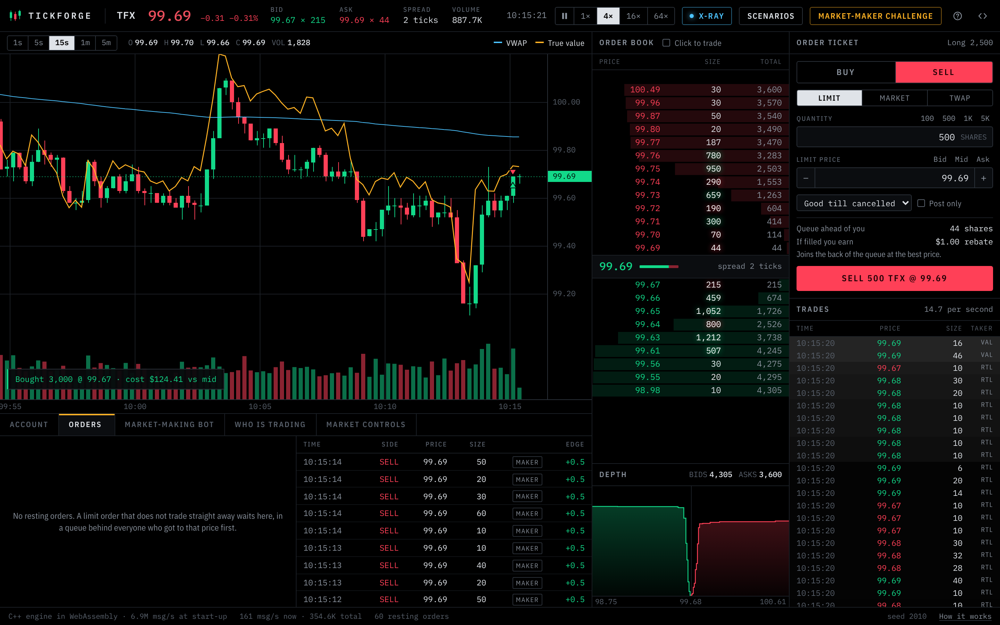
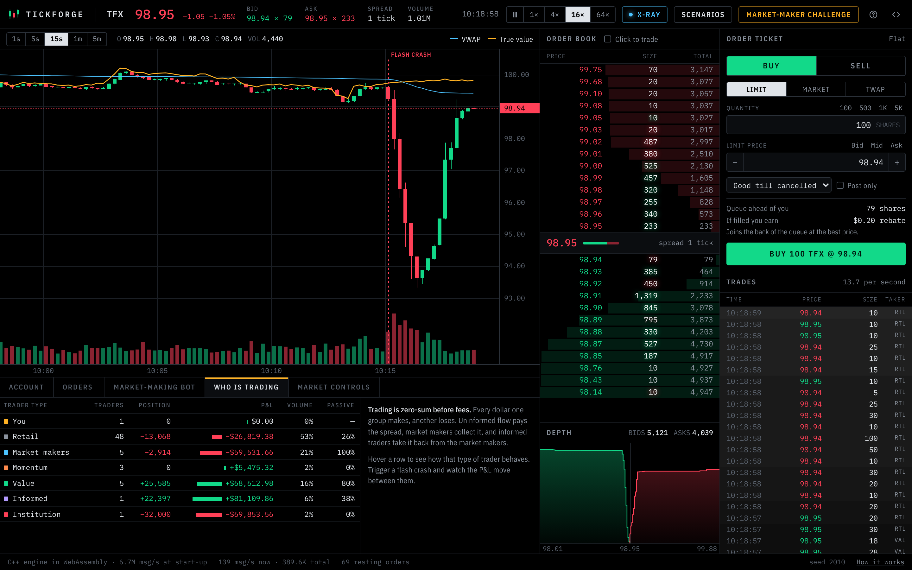
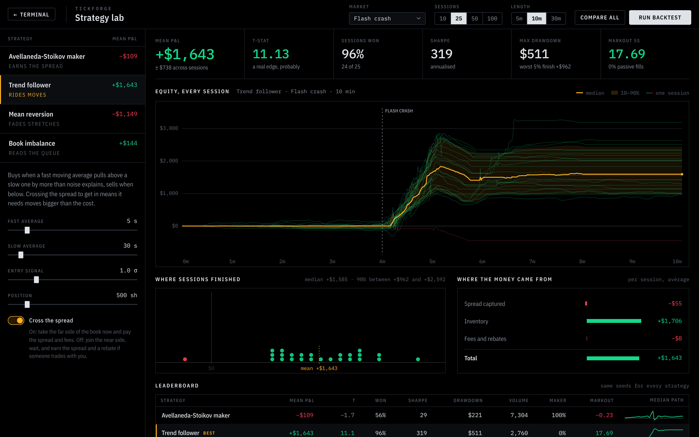
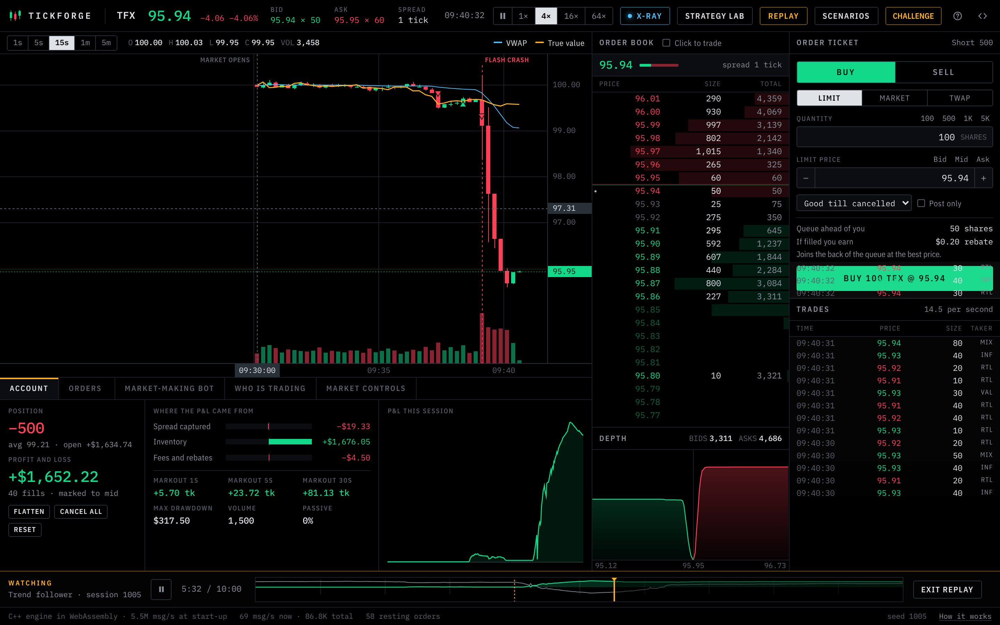
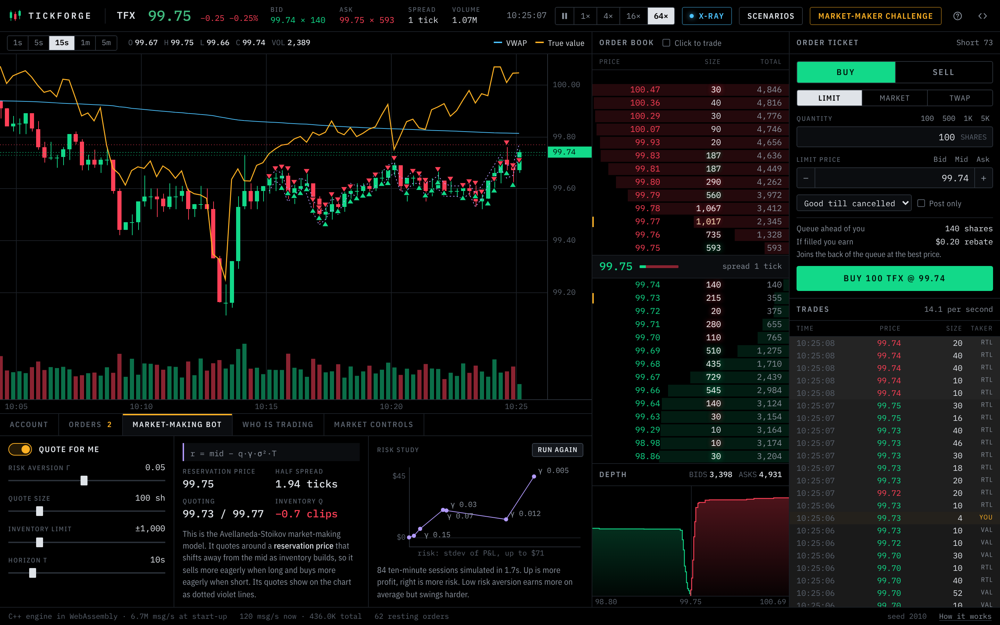

# Tickforge

**A stock exchange that runs in your browser.** A limit order book and matching engine written in C++, compiled to WebAssembly, with about sixty simulated traders sending it orders. You trade against them, run a market-making bot, or try to make markets yourself for three minutes and get graded.

**[Open the live terminal](https://haneet10.github.io/Tickforge/)**



Nothing on the screen is a recording or a random walk. Every candle is built from trades that the engine matched between simulated traders, and the price moves because of what they (and you) do.

## What you can do with it

| | |
|---|---|
| **Trade** | Limit, market and TWAP orders from the ticket, or click a price in the order book. The ticket shows your place in the queue and what crossing the spread will cost before you send. |
| **Break the market** | Trigger a flash crash, a news shock, a fat-finger order, a liquidity drought or a volatility storm and watch the book react. |
| **See who is on the other side** | X-ray mode shows the true value of the stock and which type of trader took each trade. A live table shows who is making money from whom. |
| **Run a market-making bot** | An Avellaneda-Stoikov quoting bot trades your account. A risk study replays it across 84 simulated sessions to show the trade-off between profit and risk. |
| **Take the challenge** | Three minutes as the market maker, trading blind, with news hitting at some point. You are scored against the bot playing the same market from the same seed. |
| **Backtest strategies** | The Strategy lab runs four strategies through dozens of simulated sessions on a background thread and shows every outcome, not one lucky run. |
| **Replay and share** | Every session is recorded as its seed plus your actions. Scrub back through it, send it as a link, or open any lab session and watch the strategy trade it order by order. |



## Strategy lab

**[Open the lab](https://haneet10.github.io/Tickforge/#lab)**



Pick a strategy, set its parameters, choose a market (calm, flash crash, news, whale, drought, volatility storm) and run it across 10 to 100 sessions. Each session is a fresh market from its own seed, so the lab shows the spread of outcomes: an equity curve per session with the median and the 10 to 90% band, where each session finished, and where the money came from. *Compare all* runs every strategy on the same seeds, so the leaderboard compares strategies rather than luck.

| Strategy | Edge it is after | Default execution |
|---|---|---|
| Avellaneda-Stoikov maker | Earns the spread from uninformed flow | Quotes both sides |
| Trend follower | Fast/slow moving-average crossover, scaled by volatility | Crosses the spread |
| Mean reversion | Fades prices stretched from their moving average | Joins the touch |
| Book imbalance | Bid size against ask size near the touch, held for seconds | Joins the touch |

The results tell the stories you would expect from a real market. In a calm market the maker and the passive imbalance strategy earn a small, reliable edge (t-statistics of about 8 and 12 over 25 sessions) and the trend follower loses its spread costs. Through a flash crash the trend follower makes about $1,500 a session in 24 of 25 sessions, while mean reversion buys the falling knife and loses in nearly every one. Flip the imbalance strategy to cross the spread and the same signal loses money: the signal is real but smaller than the cost of trading on it.

The same backtester runs from the command line:

```
$ ./build/tf_backtest --seeds 25 --scenario crash
  strategy                    mean P&L    stdev   t-stat    win  Sharpe   max DD    volume   maker   markout
  Avellaneda-Stoikov maker         -65      206    -1.57     56    17.5      198      8371     100     -0.07
  Trend follower                  1548      750    10.32     96   320.2      534      2920       0     16.76
  Mean reversion                 -1156      465   -12.43      0  -328.8     1722      2984     100     -8.57
  Book imbalance                   129      129     5.03     88   111.1      123     28475     100      0.65
```

`tf_backtest --list` prints every strategy's parameters; `--set window=120` changes one and `--runs` prints each session's P&L split.

## The engine

The matching engine is about 2,400 lines of C++17 with no dependencies.

| Measure | Result |
|---|---|
| Throughput, native | 38 million order operations per second on one core |
| Latency, native | 26 ns mean, 56 ns median, 148 ns at the 99th percentile |
| Throughput, in the browser | 5 to 9 million simulated messages per second (shown live in the status bar) |
| WebAssembly module | 96 KB, no generated JavaScript glue |
| Tests | 48 tests, 3.9 million checks, run under AddressSanitizer and UndefinedBehaviorSanitizer |

How it gets there:

- **Flat price levels.** Prices are integer ticks, so a level is an array slot, not a tree node. Adding to a level is one index.
- **Three-level bitmap index.** The next non-empty price level is found with a few bit operations instead of a search.
- **Pooled orders with intrusive queues.** Orders live in one contiguous pool and link to their neighbours by index. Nothing is allocated while matching.
- **Generation-checked order ids.** An id encodes its pool slot, so cancel is a direct lookup with no hash map, and a stale id can never cancel the order that reused its slot.

Order types and rules: limit and market orders; good-till-cancelled, immediate-or-cancel and fill-or-kill; post-only; reduce in place without losing queue position; self-trade prevention; price-time priority throughout.

### How I know it is correct

The book is fuzzed against a second, deliberately simple implementation written for obviousness instead of speed. Both receive the same millions of random orders and cancels and must agree on every fill, every resting order and every best price. The market simulation is checked for conservation (shares and cash sum to zero across all accounts), for determinism (the same seed gives the same market, however time is sliced), and for an exact profit and loss breakdown.

## The market

No trader is told what the price should be. It emerges from six kinds of participant:

| Trader | Behaviour |
|---|---|
| Retail flow | Uninformed. Sends random limit and market orders and pays the spread. |
| Market makers (5) | Quote both sides, widen when volatility rises, lean their quotes against inventory, and pull out when they are being run over. |
| Momentum traders (3) | Chase recent moves. |
| Value traders (5) | Lean against the price when it strays from a noisy estimate of value. |
| Informed trader | Knows the true value and picks off stale quotes. |
| Institution | Appears in scenarios, working a large order with an execution algorithm. |

The stock's true value follows a mean-reverting process with changing volatility and occasional jumps. The exchange enforces price collars and an optional circuit breaker.

The result behaves like a real market in the ways that matter: spreads widen in stress, a large seller with no price limit causes a crash that recovers once slower capital arrives, and market makers earn the spread from uninformed flow and lose part of it to informed flow.

## Honest accounting

Your profit and loss is split exactly into three parts that always sum to the total: spread captured, inventory moves, and fees. Markouts show what the price did one, five and thirty seconds after each of your trades, which is how a trading desk tells whether the people it traded with knew more than it did.

## Replays



Press **Replay** in the top bar and Tickforge plays back everything you did in the current market, with a scrubber that shows the whole session's price and P&L and a tick for every order. **Copy link** turns the session into a URL of a few hundred characters; whoever opens it watches the same market, tick for tick. **Take over** at any moment keeps the market exactly as it is and hands it back to you.

In the lab, click any equity curve (or *Watch median session*) and the terminal plays that session with the strategy trading it: its quotes in the book, its fills on the chart and the tape, its P&L in the account panel. When it finishes, the terminal checks its P&L against the one the lab reported. They agree to the cent, because the terminal drives the very same C++ session object the backtester does.

There is no video and no snapshot. A session is its seed and a list of actions, each stamped with the simulated microsecond it happened. The engine is deterministic and does not care how time is sliced, so replaying re-simulates the market from the seed and lands each action on its original microsecond. Scrubbing backwards just re-simulates from the start: 45 minutes of warm-up plus a ten-minute session takes well under 100 ms. How this is kept honest is in [docs/DESIGN.md](docs/DESIGN.md#7-replays).



## Build it yourself

Engine, tests and benchmark (needs CMake and a C++17 compiler):

```bash
cmake -S engine -B build -DCMAKE_BUILD_TYPE=Release
cmake --build build
./build/tf_tests
./build/tf_bench
./build/tf_simulate 600 7 crash     # ten simulated minutes, seed 7, with a flash crash
./build/tf_backtest                 # every strategy across 20 sessions
```

The web terminal (needs Python and Node 20 or newer):

```bash
pip install ziglang==0.17.1        # the C++ to WebAssembly compiler
./scripts/build-wasm.sh
cd web && npm ci && npm test && npm run dev
```

## Layout

```
engine/include/tf   order book, price index, market, agents, backtester
engine/src          implementation
engine/wasm         the C interface the browser calls
engine/tests        unit tests, reference book, fuzzer, market tests
engine/bench        throughput and latency benchmark
engine/tools        headless simulator and backtester for the command line
web/src             the terminal: TypeScript and canvas, no framework
web/src/lab         the Strategy lab and its Web Worker
web/src/replay      session recording, the replay player and scrubber, share links
docs/DESIGN.md      design notes
docs/roadmap.md     what is being built next
```

More detail on the data structures, the simulation and the trade-offs is in [docs/DESIGN.md](docs/DESIGN.md).

## About

Built by Haneet Singh, Mechanical Engineering at the University of Waterloo.

Every price and trader here is simulated. This is not trading advice and uses no real market data.

Released under the [MIT License](LICENSE).
